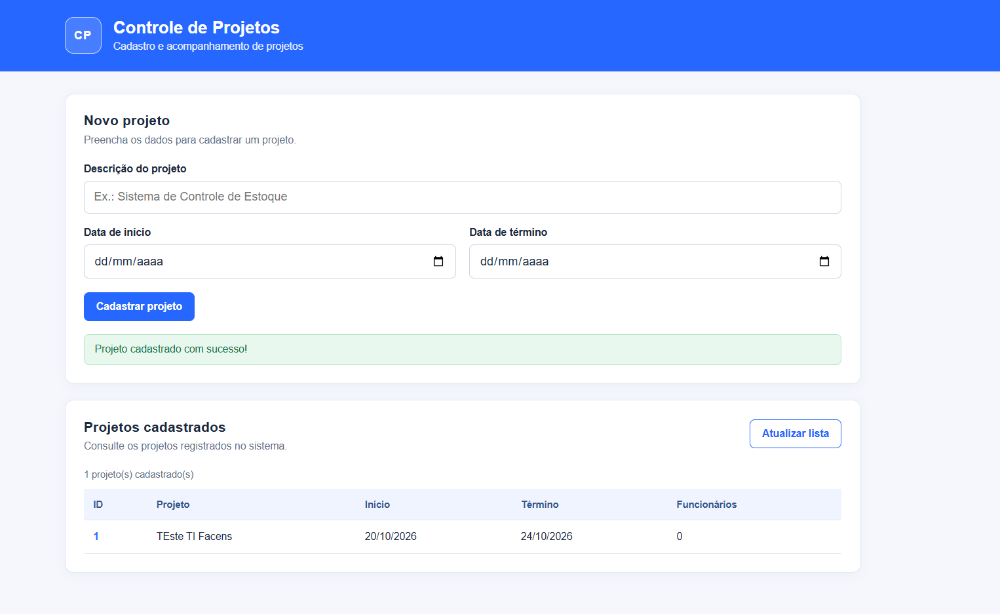

# Sistema de Controle de Projetos

Aplicação desenvolvida com Spring Boot para cadastrar setores, funcionários e projetos. A tela web permite cadastrar projetos e consultar os que já foram registrados.

## Tecnologias

- Java 17 e Spring Boot
- Spring Web e Spring Data JPA
- Banco de dados H2
- HTML, CSS e JavaScript

## Como executar

Na pasta do projeto, execute:

```powershell
.\mvnw.cmd spring-boot:run
```

Depois, acesse a tela em [http://localhost:8080](http://localhost:8080). A aplicação usa um banco H2 em memória.

## Prints da aplicação

### Banco de dados


O console do H2 mostra as tabelas `SETORES`, `FUNCIONARIOS` e `PROJETOS`. A tabela `PROJETO_FUNCIONARIO` registra os vínculos entre projetos e funcionários.

### Cadastro e consulta de setor


Requisição `POST /api/setores` com o nome do setor. A resposta `201` indica que o cadastro foi realizado.


Consulta `SELECT * FROM SETORES` no H2, exibindo o setor cadastrado e seu ID.


Requisição `GET /api/setores/1`. A API retorna os dados do setor e a lista de funcionários vinculados.


Outro print da consulta `GET /api/setores/1`, mostrando a resposta JSON com o setor e seus funcionários.

### Cadastro e consulta de funcionário


Requisição `POST /api/funcionarios` com o nome do funcionário e o `setorId`. A resposta `201` confirma o cadastro.

### Cadastro e listagem de projetos


Requisição `POST /api/projetos` com descrição, data de início e data de término. A resposta `201` confirma a criação do projeto.


Requisição `GET /api/projetos`. A resposta lista os projetos cadastrados, suas datas e os funcionários vinculados.



Tela do frontend para cadastrar um projeto e listar os projetos existentes. O print mostra uma mensagem de sucesso após o cadastro e o projeto exibido na tabela.
